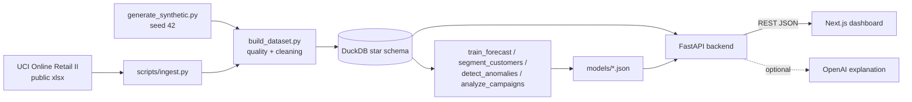

# Market Intelligence Lab

An end-to-end data science case study for understanding demand, sales performance and consumer behaviour, built as a student portfolio project on a **public** retail dataset plus a few **clearly labelled synthetic** dimensions.

## Problem
A consumer-goods business wants to know where sales come from, how much demand to expect in the coming weeks, which customers matter most, whether promotions worked, and which weeks looked unusual. This project answers those questions with reproducible analysis and shows the results in a small web app.

## Features
| Module | What it does |
|---|---|
| Overview | KPIs, revenue trend, region and category breakdown, filters |
| Sales EDA | Seasonality, weekday pattern, correlations, price/discount vs volume, distributions |
| Demand Forecast | 6 models compared on a time-based split, selected model, 8-week forecast with an approximate band |
| Campaigns | Pre/post uplift with CI, Welch test, difference-in-differences, naive ROI (synthetic campaigns) |
| Segments | RFM + K-Means (k chosen by silhouette), PCA plot, rule-based names |
| Anomalies | Robust rolling z-score on weekly revenue/units with reasons |
| Statistics Lab | Interactive Welch/Student t-test, chi-square, correlation on real orders |
| Insights | Findings generated from computed results |
| AI Analyst (optional) | Question → analytical tool → computed JSON → explanation (OpenAI or rule-based fallback) |
| Methodology | Data sources, cleaning, methods, evaluation, limitations |

## Tech Stack
Python 3.13: pandas, NumPy, SciPy, scikit-learn, statsmodels, XGBoost, DuckDB, FastAPI, Pydantic, pytest, Ruff. Frontend: Next.js 15, React 19, TypeScript, Tailwind CSS 4, Recharts, lucide-react, ESLint.

## Data
- **Real:** UCI Online Retail II (Chen, 2012), https://archive.ics.uci.edu/dataset/502/online+retail+ii, licence CC BY 4.0. 1,067,371 invoice lines, 2009-12-01 → 2011-12-09, UK online gift-ware retailer, prices in GBP.
- **Derived:** product category (keyword rules), region group, base price, discount %, calendar features.
- **Synthetic (seed 42):** 12 campaigns, pack size, market type. Campaign results are a demonstration of method, not real marketing effects.
- Details: `docs/data_dictionary.md`, `docs/data_quality_report.md` (generated).

## Methodology
Ingest → data-quality report on raw data → cleaning (duplicates, cancellations, non-positive quantity/price, non-product codes) → star schema in DuckDB (`sales` fact; `products`, `regions`, `customers`, `campaigns`, `calendar` dimensions) with foreign-key checks → models → JSON artifacts → FastAPI → Next.js. All SQL is in `backend/app/db.py`.

## Forecasting
Weekly units; last partial week dropped. Chronological split: train 81 weeks, validation 12, test 12. Models: naive, seasonal naive (lag 52), linear regression, random forest, XGBoost (lag/rolling/calendar features), damped-trend exponential smoothing. Selected by validation MAE, scored on test (one-step-ahead). Metrics: MAE, RMSE, MAPE.

## Statistical Testing
Order-level Welch/Student t-tests with 95% CIs and Cohen's d; chi-square with Cramér's V; Pearson/Spearman with Fisher-z CI; campaign DiD via OLS with HC1 errors. Significance wording is generated from p-values, and effect sizes are always shown.

## Customer Segmentation
RFM → log1p → standardise → K-Means k=2..8. Silhouette is best at k=2; the best k≥3 (k=4) is used for actionable segments. Validated against Ward clustering (adjusted Rand index). Names from rules on cluster medians.

## Anomaly Detection
Weekly revenue per region group and units for top-10 products. Robust z = (log1p value − median of previous 12 weeks) / (1.4826·MAD), flagged at |z| ≥ 3.5.

## Architecture


## Running Locally
Requires Python 3.11+ and Node 20+.

**bash (Linux/macOS)**
```bash
python -m venv .venv && source .venv/bin/activate
pip install -r backend/requirements.txt
python scripts/run_pipeline.py            # downloads data, builds DB + models
cd backend && uvicorn app.main:app --port 8000     # terminal 1
cd frontend && npm install && npm run dev          # terminal 2 → http://localhost:3000
cd backend && pytest && ruff check . && ruff format --check .
```

**PowerShell (Windows)**
```powershell
python -m venv .venv; .\.venv\Scripts\Activate.ps1
pip install -r backend\requirements.txt
python scripts\run_pipeline.py
cd backend; uvicorn app.main:app --port 8000       # terminal 1
cd frontend; npm install; npm run dev              # terminal 2
# optional AI explanations (current session only):
$env:OPENAI_API_KEY = "<your key>"
```

## Environment Variables
See `.env.example` (names only). Variables are read from the process environment.
| Name | Where | Purpose |
|---|---|---|
| OPENAI_API_KEY | backend | Optional. Enables LLM explanations; without it the rule-based fallback is used |
| OPENAI_MODEL | backend | Default `gpt-4o-mini` |
| FRONTEND_ORIGINS | backend | CORS origins |
| MIL_DB_PATH | backend | Override DuckDB path |
| NEXT_PUBLIC_API_URL | frontend | Backend URL, default http://localhost:8000 |

## Results
All numbers below come from `models/*.json` produced by the pipeline (2026-10-25 run).

**Data cleaning:** 1,067,371 raw lines → 1,002,458 clean lines (6.08% removed); 5,846 identified customers, 4,706 products, 42 countries; 0 invalid foreign keys.

**Forecast (weekly units, one-step-ahead, 12-week test window)**

| Series | Model | Val MAE | Test MAE | Test RMSE | Test MAPE % |
|---|---|---|---|---|---|
| All regions | Naive | 12,496 | 26,578 | 33,098 | 18.3 |
| All regions | Seasonal Naive | 24,541 | 26,776 | 41,174 | 20.1 |
| All regions | Linear Regression | 15,936 | 25,283 | 29,483 | 15.8 |
| All regions | Random Forest | 10,567 | 24,543 | 28,803 | 16.5 |
| All regions | XGBoost | 16,911 | 24,933 | 32,915 | 17.6 |
| All regions | Exponential Smoothing **(selected)** | 10,458 | 24,038 | 28,703 | 15.5 |
| United Kingdom | Naive | 13,867 | 21,406 | 25,298 | 17.6 |
| United Kingdom | Seasonal Naive | 14,180 | 22,004 | 34,736 | 19.3 |
| United Kingdom | Linear Regression | 12,704 | 20,940 | 24,412 | 15.8 |
| United Kingdom | Random Forest **(selected)** | 9,215 | 22,334 | 25,397 | 18.0 |
| United Kingdom | XGBoost | 9,892 | 25,752 | 32,118 | 21.5 |
| United Kingdom | Exponential Smoothing | 10,943 | 21,688 | 24,620 | 17.2 |
| Western Europe | Naive | 6,549 | 7,910 | 10,187 | 67.7 |
| Western Europe | Seasonal Naive | 9,521 | 7,929 | 9,932 | 57.8 |
| Western Europe | Linear Regression | 8,284 | 6,374 | 7,761 | 49.6 |
| Western Europe | Random Forest | 3,863 | 6,093 | 8,336 | 41.0 |
| Western Europe | XGBoost **(selected)** | 3,224 | 5,869 | 8,350 | 39.4 |
| Western Europe | Exponential Smoothing | 4,786 | 5,189 | 7,675 | 33.0 |
| Ireland & Channel Is. | Naive | 2,869 | 3,495 | 4,515 | 316.4 |
| Ireland & Channel Is. | Seasonal Naive | 4,738 | 3,045 | 4,040 | 199.1 |
| Ireland & Channel Is. | Linear Regression | 2,434 | 2,252 | 2,727 | 170.3 |
| Ireland & Channel Is. | Random Forest | 2,888 | 1,973 | 2,600 | 151.7 |
| Ireland & Channel Is. | XGBoost | 3,666 | 2,947 | 3,526 | 192.7 |
| Ireland & Channel Is. | Exponential Smoothing **(selected)** | 2,374 | 2,152 | 2,602 | 118.6 |

Full per-model results are in `models/forecast_results.json` and the Forecast page. For "All regions" exponential smoothing cuts test MAE by 9.6% vs the naive baseline; for small series the gain is noisier and MAPE is high because of low volumes.

**Segments (k=4, silhouette 0.365, ARI vs Ward 0.497):** High Value 1,190 customers / 73.7% of revenue; At Risk (Lapsed Regulars) 1,445 / 16.4%; Loyal / Regular 1,259 / 6.3%; Low Engagement / Lapsed 1,952 / 3.7%.

**Campaigns (synthetic):** 7 of 12 have enough pre/post data; no pre/post Welch test is significant at 5%; one DiD estimate (campaign 6) has p = 0.008, which is expected by chance among this many tests on synthetic labels.

**Anomalies:** 57 flagged weeks.

**Quality checks:** 38 backend tests pass; Ruff, ESLint, `tsc --noEmit` and `next build` clean.

## Limitations
Synthetic campaigns; observational analysis only; one mostly-UK wholesale retailer from 2009–2011; about two years of history (one seasonal cycle); no external drivers; keyword-based categories; ~23% of lines lack a customer ID; MAPE unstable for low-volume series. See the Methodology page.

## Future Work
Prediction intervals via quantile models or conformal methods; hierarchical (region → total) reconciliation; rolling-origin backtesting; price-elasticity model; a CI workflow; deployment.
