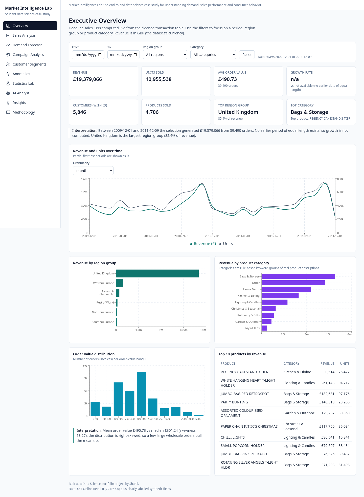
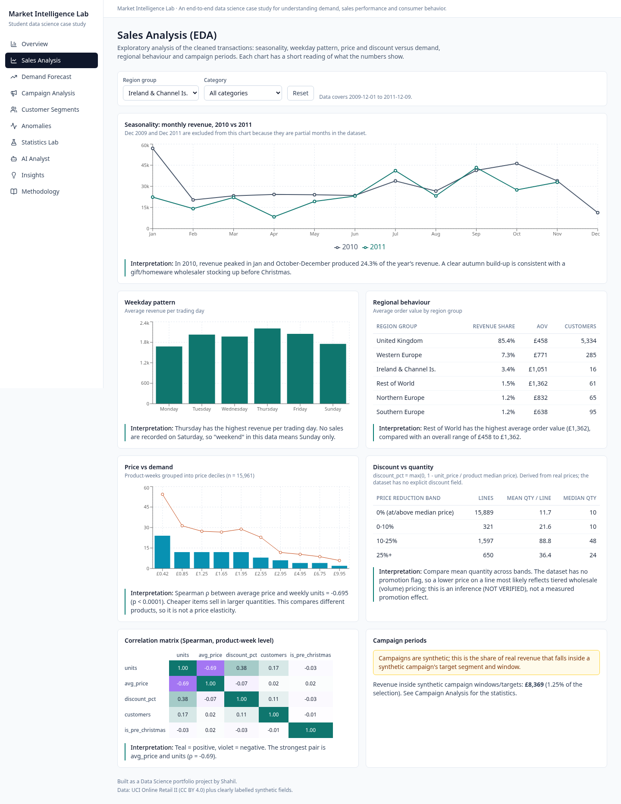
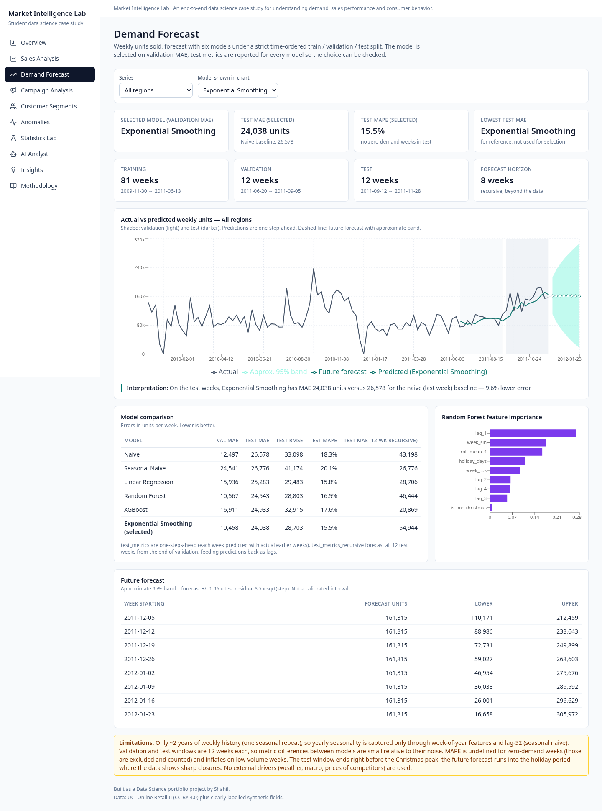
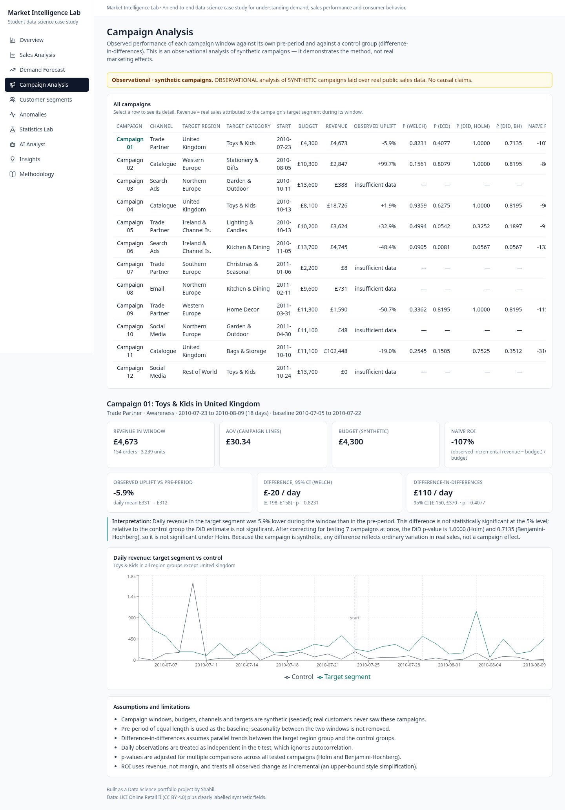
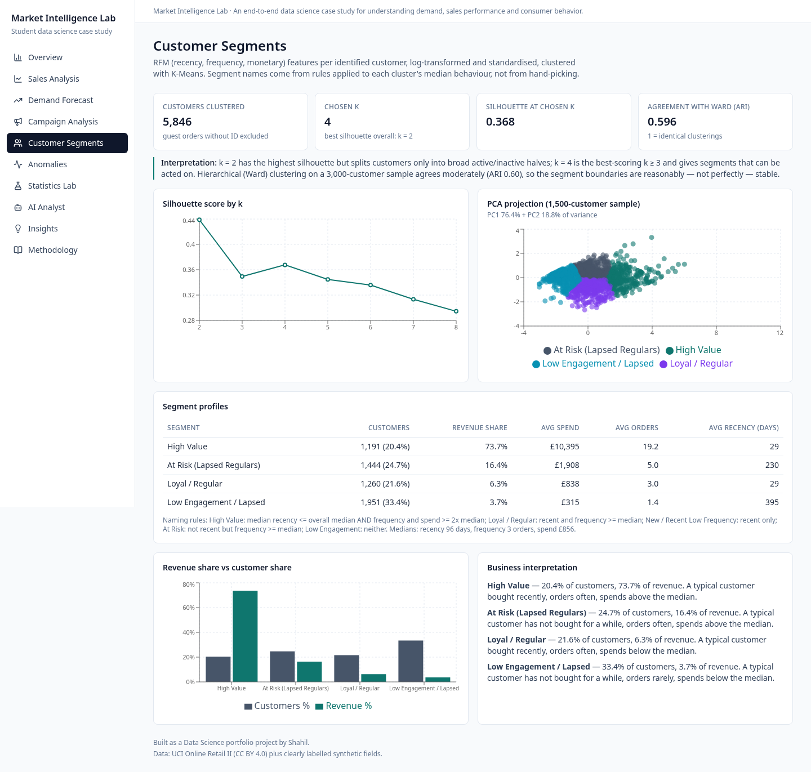
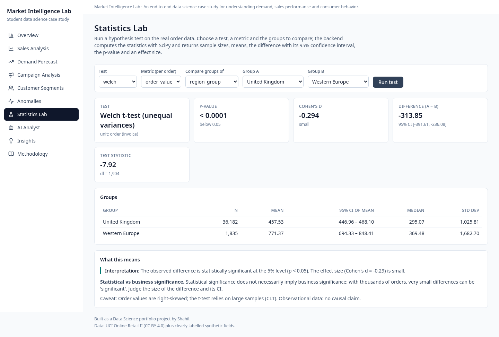
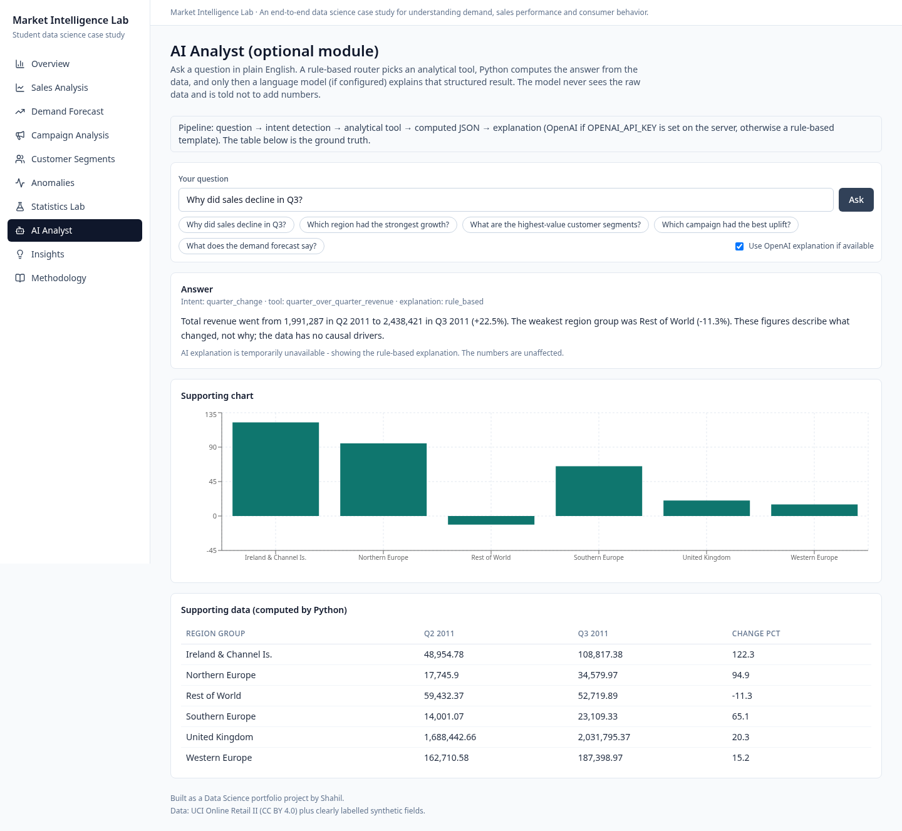
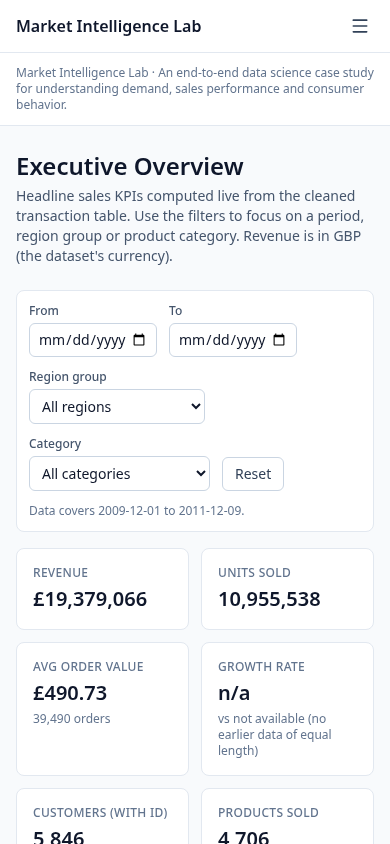
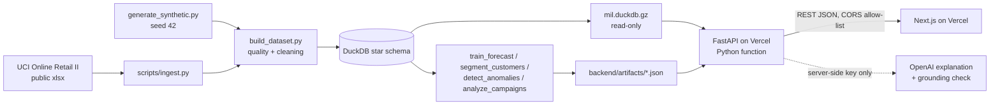

# Market Intelligence Lab

A student data science portfolio project. It looks at sales, demand, customers and promotions in a **public** retail dataset (plus a few **clearly labelled synthetic** fields). The project runs from raw data to a live web app.

## Demo
- **Live app:** https://market-intelligence-lab.vercel.app
- **API:** https://mil-api-shahils-projects-e75357dc.vercel.app (`GET /health` returns `{"status":"ok"}`)

| Overview | Sales |
|---|---|
|  |  |
| **Forecast** | **Campaigns** |
|  |  |
| **Segments** | **Statistics Lab** |
|  |  |
| **AI Analyst** | **Mobile (Overview)** |
|  |  |

Mobile screenshots of every page are in `docs/screenshots/*-mobile.png`.

## Overview
The question: where do sales come from, how much demand should we expect, which customers matter, did promotions work, and which weeks looked unusual? A Python pipeline cleans the data and builds a DuckDB star schema. It then fits the models and writes JSON results. A FastAPI backend serves those results, plus live SQL aggregates, to a Next.js dashboard. Every number in the UI comes from the API.

## Key Features
| Page | What it does |
|---|---|
| Overview | KPIs, revenue trend, region and category breakdown, date/region/category filters |
| Sales | Seasonality, weekday pattern, correlations, price/discount vs volume, distributions |
| Forecast | 6 models compared on a time-based split (one-step and 12-week recursive backtests), 8-week forecast |
| Campaigns | Pre/post uplift with CI, Welch test, difference-in-differences, Holm and BH corrected p-values (synthetic campaigns) |
| Segments | RFM + K-Means, silhouette for k, Ward cross-check, PCA plot |
| Anomalies | Robust MAD z-score on weekly series, each flag with its reason |
| Statistics Lab | Interactive Welch/Student t-test, chi-square, correlation on real orders |
| AI Analyst | Question → fixed analytical tool → computed JSON → explanation (OpenAI, with a rule-based fallback) |
| Insights, Methodology | Findings generated from results; data sources, methods, limitations |

Every page has loading skeletons, empty states and friendly error states ("Unable to load sales data. Please try again." with a Retry button).

## Data
- **Real:** UCI Online Retail II, Chen, D. (2012), UCI Machine Learning Repository, https://archive.ics.uci.edu/dataset/502/online+retail+ii. Licensed under **CC BY 4.0** (https://creativecommons.org/licenses/by/4.0/). Data is used with attribution; I changed it by cleaning it, adding derived columns and aggregating it. It has 1,067,371 invoice lines from a UK online gift-ware retailer, 2009-12-01 → 2011-12-09, with prices in GBP.
- **Derived:** product category (keyword rules), region group, base price, discount %, calendar features.
- **Synthetic (seed 42):** 12 campaigns, pack size and market type. Campaign results only show the method. They are **not** real marketing effects.
- The raw data is **not** in git. `scripts/ingest.py` downloads it.
- **Shipped database:** `backend/artifacts/mil.duckdb.gz` (6.2 MB gzip, 14.4 MB unpacked) is committed. On a cold start the API unpacks it to the temp directory and opens it **read-only**. Why this choice: the app is read-only analytics on a fixed historical dataset. An embedded columnar DB keeps all SQL in one place and needs no paid server or connection secrets. It also fits Vercel's function size limits. A hosted Postgres would add cost and a credential for no analytical gain.
- More detail: `docs/data_dictionary.md` and `docs/data_quality_report.md` (both generated).

## Data Pipeline
`python scripts/run_pipeline.py` runs every step (about 16 s once the raw file is cached):
1. Ingest the raw xlsx and run a data-quality report on the raw lines.
2. Clean: remove duplicates, cancellations, non-positive quantity or price, and non-product codes.
3. Build the DuckDB star schema: a `sales` fact plus `products`, `regions`, `customers`, `campaigns` and `calendar` dimensions, with foreign-key checks.
4. Fit forecasts, segments, anomalies and campaign analysis, and write JSON to `backend/artifacts/`.
5. Pack the DB as a gzip for the API.

The result: 1,002,458 clean lines (6.08% removed), 5,846 identified customers, 4,706 products, 42 countries and 0 invalid foreign keys.

## EDA
The Sales page covers:
- monthly seasonality (a strong Q4 peak)
- the weekday pattern
- correlations between price, discount, quantity and revenue
- price/discount against volume
- order-value distributions

All SQL lives in `backend/app/db.py`.

## Demand Forecasting
- **Target:** weekly units (105 weeks; the last partial week is dropped).
- **Split:** chronological, with train 81 weeks, validation 12 and test 12.
- **Models:** naive, seasonal naive (lag 52), linear regression, random forest, XGBoost (lag/rolling/calendar features) and damped-trend exponential smoothing.
- **Selection:** by validation MAE.
- **Two test views:**
  - one-step-ahead: each week is predicted from the actual earlier weeks
  - recursive: all 12 test weeks are forecast from the end of validation, with predictions fed back as lags

## Campaign Analysis
For each campaign, daily revenue in the target region before and during the campaign is compared using:
- a Welch t-test and a 95% CI on the difference
- difference-in-differences against other regions (OLS with HC1 errors)
- naive ROI

Twelve campaigns means twelve tests, so p-values are adjusted with **Holm** (family-wise error) and **Benjamini–Hochberg** (FDR).

## Customer Segmentation
- RFM → log1p → standardise → K-Means for k = 2..8.
- Silhouette is best at k=2. The best k≥3 (k=4) is used so the segments are actionable.
- Cross-checked against Ward clustering with the adjusted Rand index.
- Segment names come from rules on cluster medians.

## Anomaly Detection
- Covers weekly revenue per region group and weekly units for the top-10 products.
- Robust z = (log1p value − median of the previous 12 weeks) / (1.4826 · MAD).
- Flagged when |z| ≥ 3.5; each flag says whether it was a spike or a drop and by how much.

## Statistical Analysis
The Statistics Lab runs on real order-level data:
- Welch/Student t-tests with 95% CIs and Cohen's d
- chi-square with Cramér's V
- Pearson/Spearman with a Fisher-z CI

The wording ("significant at 5%") is generated from the p-value, and effect sizes are always shown next to it.

## AI Data Analyst
1. A keyword router maps the question to one of 8 fixed Python tools: quarter change, region growth, segments, forecast, campaigns, anomalies, top products, overview. The model never writes SQL or picks tools.
2. The tool computes a JSON result.
3. `gpt-4o-mini` is asked to explain **only** that JSON. The question is passed as untrusted, delimited text.
4. A **grounding check** pulls every number out of the answer and rejects the answer if any number is not in the computed result.
5. If there is no key, the API fails, or the grounding check fails, a rule-based explanation is shown instead. The endpoint still returns 200 with the same numbers.

Prompt-injection tests ("ignore previous instructions…") confirm the tool and numbers cannot be changed.

## Architecture


## Tech Stack
- **Data and modelling:** Python 3.13 with pandas, NumPy, SciPy, scikit-learn, statsmodels, XGBoost and DuckDB.
- **Backend:** FastAPI, Pydantic and the OpenAI SDK; tested with pytest and linted with Ruff.
- **Frontend:** Next.js 15, React 19, TypeScript, Tailwind CSS 4 and Recharts.
- **Hosting:** Vercel (two projects).

## Results
These are measured values from the pipeline run on 2026-10-25, taken from `backend/artifacts/*.json`.

**Forecast, weekly units, 12-week test window.** Columns are validation MAE, test MAE / RMSE / MAPE (one-step), and test MAE (12-week recursive).

| Series | Model | Val MAE | Test MAE | Test RMSE | Test MAPE % | Test MAE (recursive) |
|---|---|---|---|---|---|---|
| All regions | Naive | 12,496 | 26,578 | 33,098 | 18.3 | 43,198 |
| All regions | Seasonal Naive | 24,541 | 26,776 | 41,174 | 20.1 | 26,776 |
| All regions | Linear Regression | 15,936 | 25,283 | 29,483 | 15.8 | 28,706 |
| All regions | Random Forest | 10,567 | 24,543 | 28,803 | 16.5 | 46,444 |
| All regions | XGBoost | 16,911 | 24,933 | 32,915 | 17.6 | 20,869 |
| All regions | Exponential Smoothing **(selected)** | 10,458 | 24,038 | 28,703 | 15.5 | 54,944 |
| United Kingdom | Random Forest **(selected)** | 9,215 | 22,334 | 25,397 | 18.0 | 48,047 |
| Western Europe | XGBoost **(selected)** | 3,224 | 5,869 | 8,350 | 39.4 | 5,515 |
| Ireland & Channel Is. | Exponential Smoothing **(selected)** | 2,374 | 2,152 | 2,602 | 118.6 | 2,132 |

What the forecast numbers show:
- For "All regions", exponential smoothing cuts one-step test MAE by 9.6% against naive.
- Over a 12-week recursive horizon it does poorly (54,944), and XGBoost is best (20,869).
- The model choice therefore depends on the horizon, and with only 12 test weeks the gaps between models are small relative to the noise.
- MAPE is high for the small series because volumes are low.
- Full results are on the Forecast page.

**Segments:** k=4, silhouette 0.368 (k=2: 0.439), ARI against Ward 0.596, PCA 76.4% + 18.8% of variance.

| Segment | Customers | Share of revenue |
|---|---|---|
| High Value | 1,191 | 73.7% |
| At Risk (Lapsed Regulars) | 1,444 | 16.4% |
| Loyal / Regular | 1,260 | 6.3% |
| Low Engagement / Lapsed | 1,951 | 3.7% |

**Campaigns (synthetic):**
- 7 of 12 have enough pre/post data.
- No Welch test is significant.
- Campaign 06's DiD has a raw p of 0.0081, but that becomes 0.0567 after Holm and after BH, so it is **not significant** once multiple testing is accounted for.

**Anomalies:** 57 flagged weeks.

**Quality:**
- 45 backend tests pass.
- Ruff, ESLint, `tsc --noEmit` and `next build` are clean.
- Playwright checked the live site at 1440 px and 390 px.

## Limitations
- The campaigns are synthetic, and all of the analysis is observational, so it shows no causal effects.
- The data is one mostly-UK wholesale gift retailer from 2009–2011, with about two years of history (a single seasonal cycle) and no external drivers such as price competition or weather.
- Product categories come from keyword rules, and about 23% of lines have no customer ID, so segmentation covers registered customers only.
- MAPE is unstable for low-volume series, and the 12-week test window is short.
- Forecast bands are approximate (residual-based), not calibrated intervals.
- The AI Analyst answers only the 8 supported question types.

## Running Locally
You need Python 3.11+ and Node 20+.

**bash (Linux/macOS)**
```bash
python -m venv .venv && source .venv/bin/activate
pip install -r requirements-dev.txt
python scripts/run_pipeline.py                      # downloads data, builds DB + models
cd backend && uvicorn app.main:app --port 8000      # terminal 1
cd frontend && npm install && npm run dev           # terminal 2 -> http://localhost:3000
cd backend && pytest && ruff check .                # tests
export OPENAI_API_KEY=...                           # optional, current shell only
```

**PowerShell (Windows)**
```powershell
python -m venv .venv; .\.venv\Scripts\Activate.ps1
pip install -r requirements-dev.txt
python scripts\run_pipeline.py
cd backend; uvicorn app.main:app --port 8000        # terminal 1
cd frontend; npm install; npm run dev               # terminal 2
$env:OPENAI_API_KEY = "<your key>"                  # optional, current session only
```

The committed `backend/artifacts/mil.duckdb.gz` means the API also runs **without** the pipeline: just install `backend/requirements.txt` and start uvicorn.

## Environment Variables
Names only; see `.env.example`. Never commit real values.

| Name | Project | Purpose |
|---|---|---|
| OPENAI_API_KEY | backend only (server-side) | Optional; enables LLM explanations |
| OPENAI_MODEL | backend | Default `gpt-4o-mini` |
| FRONTEND_URL | backend | Production frontend origin for CORS |
| FRONTEND_ORIGINS | backend | Extra comma-separated CORS origins (wildcards are rejected) |
| MIL_DB_PATH / MIL_ARTIFACTS_DIR | backend | Optional path overrides |
| NEXT_PUBLIC_API_URL | frontend | Backend base URL |

## Project Structure
```
scripts/            data pipeline (run_pipeline.py runs all steps)
backend/app/        FastAPI: api/routes.py, db.py (all SQL), services/, schemas/
backend/artifacts/  model JSON + mil.duckdb.gz shipped with the API
backend/tests/      pytest suite
frontend/app/       Next.js pages (one folder per page)
frontend/components shared UI (Card, Status, Skeleton, Sidebar, FilterBar)
data/processed/     synthetic dimension CSVs (raw data is downloaded, not committed)
docs/               data dictionary, data-quality report, screenshots
```

## Future Improvements
- Calibrated prediction intervals, using quantile models or conformal prediction.
- Rolling-origin backtesting and hierarchical reconciliation (region → total).
- A price-elasticity model.
- A CI workflow (GitHub Actions) running the tests and lint on every push.
- An LLM-based intent router with the same grounding check.

## Licence
Code: MIT (see `LICENSE`). Data: UCI Online Retail II, CC BY 4.0, with attribution as above; derived data in this repo carries the same licence.
